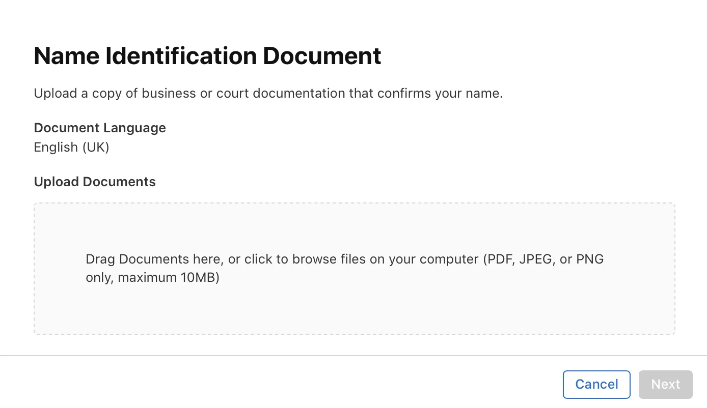

You ever take a photo of a document for some official process and then had to
convert from `.HEIC` to something that websites will actually accept before you
could upload it? I sure have. Understandable when it's a website run by normies
but today I was sorting out my official documentation for an App Store release
and had the same problem.

<figure>
 
</figure>

I dunno I thought that was quite damning, really. HEIC has had 9 years to win
the world over and it hasn't even won the whole of Apple over yet.
