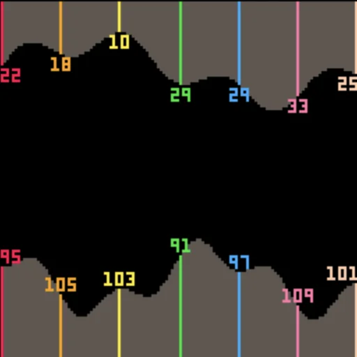
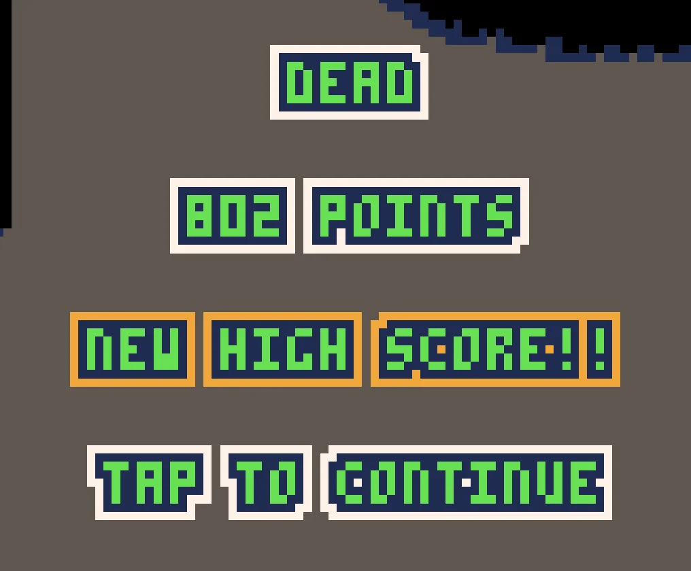

My game [Nosedive](https://henry.catalinismith.se/nosedive/) is finally finished after
years of on-again-off-again development and I feel like writing down how the
procedural terrain generation works, so this is that.

The game’s a one button game where you fly a helicopter through a cave and
collect coins. Maxing out the combo bar gives you a speed boost and temporary
invincibility, and the coins are worth more points the faster you’re going.
Looks like this.

<figure>
 <video controls preload="none" poster="/2026/11/11/nosedive-poster@512x512.webp">
  <source src="/2026/11/11/nosedive@512x512.mp4" type="video/mp4">
 </video>
</figure>

It’s inspired by the old Flash classic Helicopter Game, which is a little more
slow paced but has the same basic helicopter + tunnel concept, and looks like
this.

<figure>
 <video controls preload="none" poster="/2026/11/11/helicopter-game-poster@960x722.webp">
  <source src="/2026/11/11/helicopter-game@960x722.mp4" type="video/mp4">
 </video>
</figure>

The cave generation is the fun part of building something like this. In fact,
every time I’ve tried to work on finishing the game I’ve always become fixated
on the cave generation code instead, and forgotten about the rest of the game.
That’s probably why it’s older than either of my kids and only just shipped
now.

The cave needs to have a few special properties. Most importantly, it needs to
be different every time you play. It also needs to be infinitely long while
using as little memory as possible. And because of the speed boost game
mechanic, the cave geometry needs to be more forgiving at higher speeds so that
the speed boost isn’t just a boring anticlimactic death sentence.

The screen for a PICO-8 game is always 128x128 pixels, so we need to store
exactly 128 vertical slices of cave in memory in order to render any given
screen. And the cave always has a roof and a floor, so that’s two numbers per
slice.

```lua
cave = { {22, 95}, …}
```

Here’s a visualization of the above in terms of how the numbers map to the
actual cave you see in the game.


<figure>
 
</figure>

A fun detail about how Nosedive works is that under the hood, the helicopter
doesn’t actually go anywhere. The cave and the smoke move, and the helicopter
just flies up and down in place. And each time the cave moves, the first slice
on the left gets forgotten and a new last slice gets added onto the end,

The obvious way to implement this would be to loop through the cave shifting
each element along by one. That gives you a really easy-to-understand
relationship between the data structure and what’s on the screen: `cave[1]` is
always the bit of cave right at the left edge of the screen. It’s not very
efficient though, as it means you have to do 128 write operations for every
single pixel of horizontal motion.

At some point I went on (I think) ChatGPT, and asked it how to speed that up.
And as a result of that question, I learned about one of my fav data
structures, the [circular
buffer](https://en.wikipedia.org/wiki/Circular_buffer), which I’m excited to
tell you about.

> The useful property of a circular buffer is that it does not need to have its elements shuffled around when one is consumed. (If a non-circular buffer were used then it would be necessary to shift all elements when one is consumed.) In other words, the circular buffer is well-suited as a FIFO (first in, first out) buffer while a standard, non-circular buffer is well suited as a LIFO (last in, first out) buffer.
> 
> https://en.wikipedia.org/wiki/Circular_buffer#Uses

In Nosedive, that means that instead of shifting the entire cave along by one,
there’s a `cave_head` variable that tracks which of the 128 elements is the
current “start” of the cave which gets incremented. And a fun result of that is
that what I said before about the helicopter not really moving is kind of also
true of the cave under the hood.

Here’s a side by side visualization where the top half shows what’s rendered by
the `_draw_` function and the bottom half shows how the data structure actually
looks underneath for each frame. The little arrow represents the `cave_head`
variable.

<figure>
 <video controls preload="none" poster="/2026/11/11/circular-poster@512x512.webp">
  <source src="/2026/11/11/circular@512x512.mp4" type="video/mp4">
 </video>
</figure>

At this point the need for the cave to be infinitely long while using as little
memory as possible is fulfilled. What’s left is the procedural generation
itself, which Nosedive handles with little `terrain` functions like these.

```lua
function static(y)
 return terrain(
  function(p)
   return y
  end
 )
end

function sinewave(magnitude, frequency)
 return terrain(
  function(p)
   return sin(p * frequency) * magnitude
  end
 )
end
```

Each one of these gets a value `p` which can vary from 0 to 1 A little bit of
[metatable metaprogramming magic](https://www.lua.org/pil/13.1.html) lets you
combine them together in different ways using `+` and `%` and so on. Then
they’re combined together into “chunks”, which have one terrain function for
the roof of the cave and another for the floor. A chunk is 128 pixels wide, and
the `p` parameter is 0 at the start of the chunk and 1 at the end.

```lua
function tunnel(d, h)
 return chunk(
  static(d) + noise(1),
  static(d + h) + noise(1)
 )
end

function sinechunk(m, f)
 return chunk(
  sinewave(m,f),
  sinewave(m,f)
 )
end
```

This is a lot of quite ambitious metaprogramming. It was a tough architecture
to get working and I had to make a lot of scratch carts to understand my own
idea properly and iron out all the bugs. Here’s one of them,
[`nosedive-chunks.p8`](https://github.com/henrycatalinismith/nosedive/blob/main/nosedive-chunks.p8),
which renders the cave boundaries of a bunch of different chunks as red lines.

<figure>
 <video controls preload="none" poster="/2026/11/11/nosedive-chunks-poster@512x512.webp">
  <source src="/2026/11/11/nosedive-chunks@512x512.mp4" type="video/mp4">
 </video>
</figure>

Borrowing further from Minecraft’s vocabulary, chunks are then grouped into
“biomes”, so that several screenfuls of similar-looking terrain can be packaged
up into one coherent thing. Here’s
[`nosedive-biomes.p8`](https://github.com/henrycatalinismith/nosedive/blob/main/nosedive-chunks.p8),
which zooms way out and renders a bunch of different biomes one after another
really fast.

<figure>
 <video controls preload="none" poster="/2026/11/11/nosedive-biomes-poster@512x512.webp">
  <source src="/2026/11/11/nosedive-biomes@512x512.mp4" type="video/mp4">
 </video>
</figure>

This structure provides enough leverage to make the cave different each time
and balance the difficulty of the cave for the higher speeds. The novelty comes
from randomizing the parameters, and the balance comes from setting different
thresholds and rules for the different speeds.

Not that the game is particularly well-balanced, though. One of the big downsides
of having a game in development for so many years is that you get far too much
time to playtest it and end up becoming far too good at your own game. Everyone
who plays is complains it's too hard and they can barely survive a few seconds
and meanwhile I'm doing this.

<figure>
 <video controls preload="none" poster="/2026/11/11/466-poster@640x640.webp">
  <source src="/2026/11/11/466@640x640.mp4" type="video/mp4">
 </video>
</figure>

I should probably rebalance it but I can't stand the thought of putting it back
into "in-development" status after all these years or making the game boring
for me personally to play. With Tailbone I solved the second part by making a
[much harder "disk 2"
version](https://henry.catalinismith.se/tailbone/disk2.html) for myself to play
but Nosedive just needs to be finished at this point, for better or worse!

[Give it a try](https://henry.catalinismith.se/nosedive/) and let me know if
you if you beat my high score!

<figure>
 
</figure>

