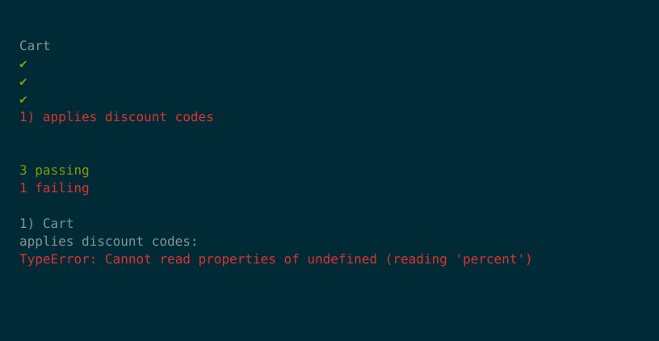
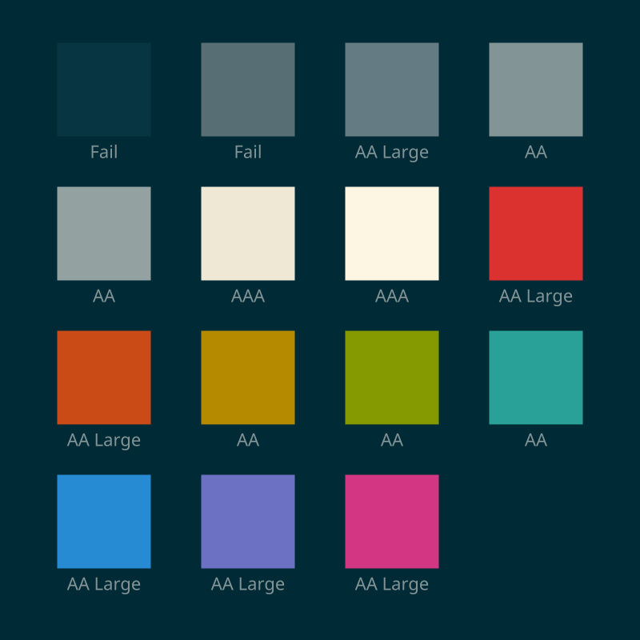
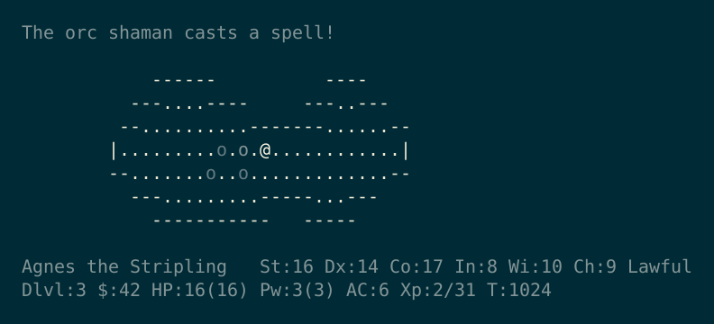
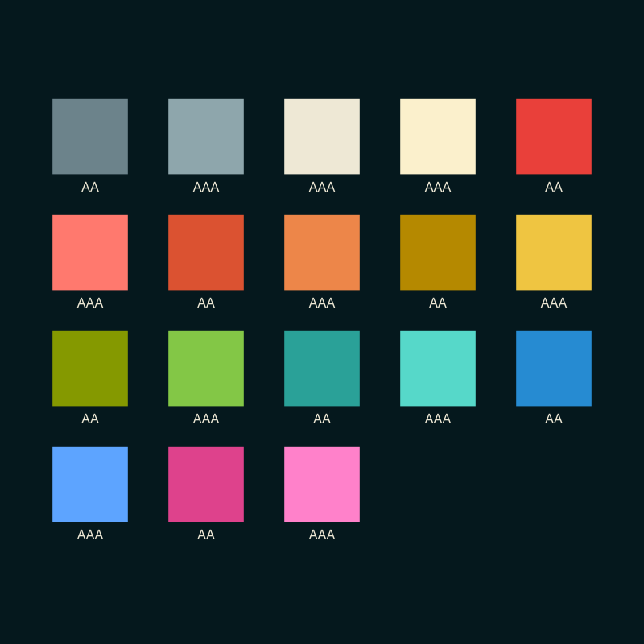
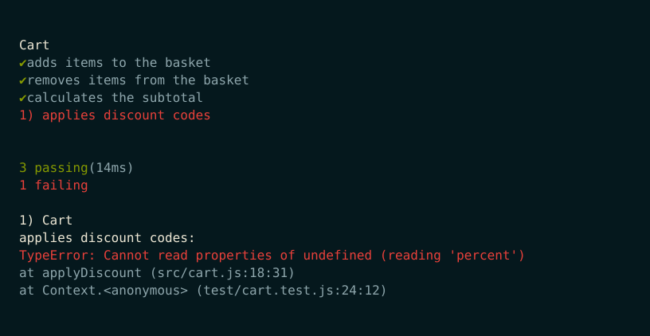
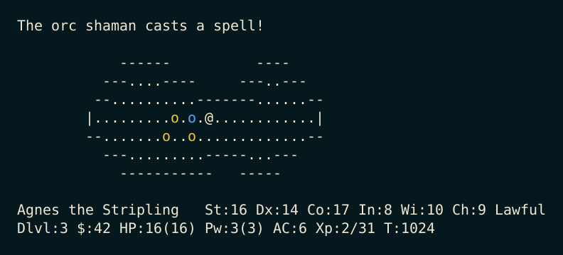
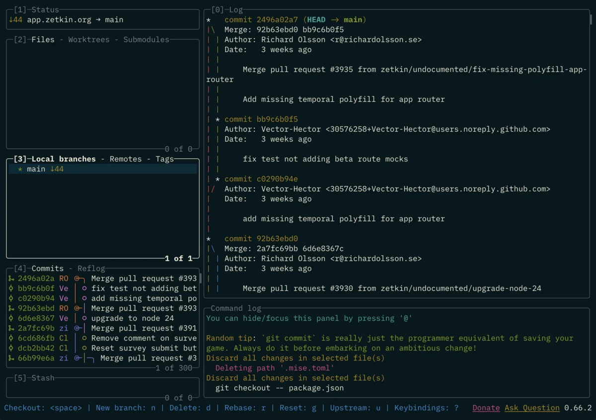
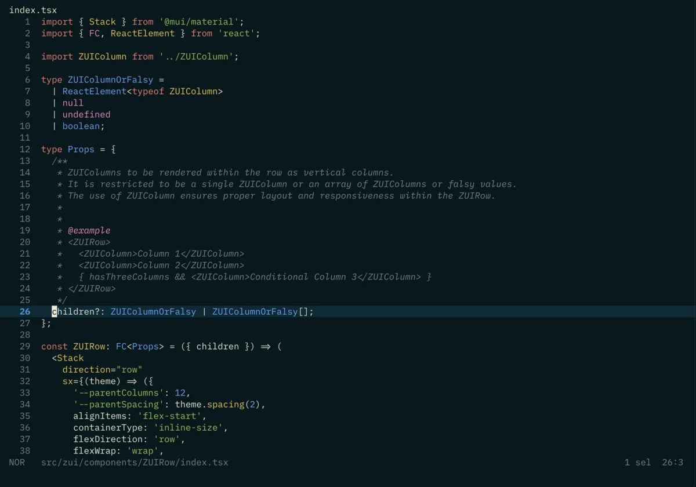

Over the past year or so I've finally gotten around to fixing the contrast
problems in the [Solarized](https://ethanschoonover.com/solarized/) colour
palette. Darkstar is what I've been calling my private fork with the fixes.

For early 2010s Vim users, Solarized was a minor cultural phenomenon. Ethan's
site with his description of the thought process behind it is an
underappreciated bit of marketing work. That tagline "Precision colors for
machines and people" is brilliant. This was _looooong_ before you could push a
button to churn out a slick landing page full of generic cokehead yank salesman
lingo and it went down very well indeed. Solarized was everywhere.

It's funny how certain things can get locked in to your psyche just because you
happened to pick them up early in life. I was using Solarized in the most
formative and prolific years of my career, and as a result, it's a visual "home"
for me at some deep psychological level.

Only trouble is, it often doesn't work well with real world software. There's
nowhere near enough colours or contrast in the palette, and you end up losing
all kinds of information as a result. Most problematic of all are all the
colours that are almost identical to the background colour. The design intent of
the palette is that those should not be used as foreground colours. Many do
though. When Mocha was the trendy JavaScript unit testing framework, this was
what the output looked like in Solarized.

The text after the checkmarks has been themed using a colour that Solarized
considers a background colour. As a result, it's invisible. For years I would
work around this by selecting blocks of text in the terminal to reveal them
with the selection highlight background, like a kid doing one of those
lemon juice & candle hidden message craft projects.

Ultimately this is a design flaw in Solarized.
The world of terminal programs is chaotic and to create a theme for it you have
to engage with that chaos. You can't unilaterally imagine away the reality that
authors of terminal software expect all available palette colours to be
available for usage as foreground colours.

Solarized ships with two colours whose WCAG contrast ratios are an outright
`FAIL` rating against the background colour. Several of the foreground colours
are only rated `AA Large` too, which means they're technically below the WCAG
thresholds at the smaller font sizes 99% of people use in practice.

It also doesn't ship anything for the "bright" colour variants that terminals
expect. Instead it fills many of those "bright" gaps with various greys. Since many
authors of terminal software expect those colours to be available for use, this
ends up breaking tons of programs. In NetHack, it leads to certain types of
monster looking almost identical to each other. In the scene below, the player is in a room
with three hill orcs and one orc shaman. The bright blue orc shaman should be
very distinctive from the bright yellow hill orcs, but instead all four are just
grey.

Darkstar addresses these problems first by massively darkening the background
colour. This measure alone is enough to avoid the invisible text problem. Every
colour has at least an `AA` rating against the background. It then also defines
proper bright variants for each colour so that they're possible to tell apart
from one another. This fixes all the issues caused by information encoded using
colour. It's a dramatic change, but I've found in practice my expectations easily
adjust to the new darker background, while the familiarity of the foreground
colours preserves the sense of "home" in the overall palette. It looks almost
black in a small sample image in the middle of a screen of different colours,
but in real usage when it fills most of the screen it looks a lot more blue.

Here's the exact same Mocha output as the example earlier, with the new colours
applied. No more selection highlight decoder ring workflow here.

And finally here's that same NetHack scene from before. Turns out the orc shaman
was the one right next to us! Good to know!

The name's a Slackware reference. If you don't set a hostname during
installation of Slackware, it sets it to `darkstar` for you. Installing
Slackware 10.0 from a Linux Format CD was a turning point in my life and
I have even more nostalgia for that experience of first discovering Linux than
for the early 2010s Vim usage.

For now Darkstar is just for my own personal use in [my
dotfiles](https://github.com/henrycatalinismith/dotfiles/). You're very welcome
to borrow or steal ideas from it for yourself, and if one or two people [email
me asking for a proper set of installable themes for different
stuff](mailto:henry@catalinismith.se?subject=Please%20package%20Darkstar%20as%20an%20installable%20theme%20for%20loads%20of%20different%20things%20so%20I%20can%20give%20it%20a%20try!)
I will definitely do that.

Here's a couple of screenshots of it in action. 

---

Edit:
https://henry.catalinismith.se/darkstar/
